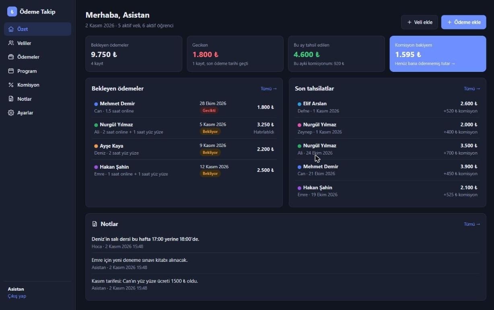
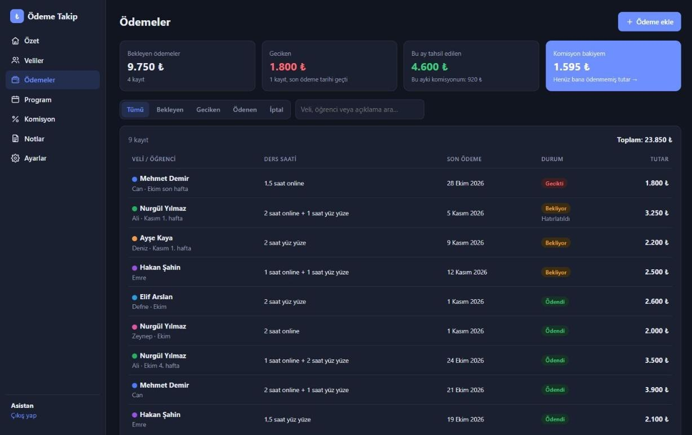
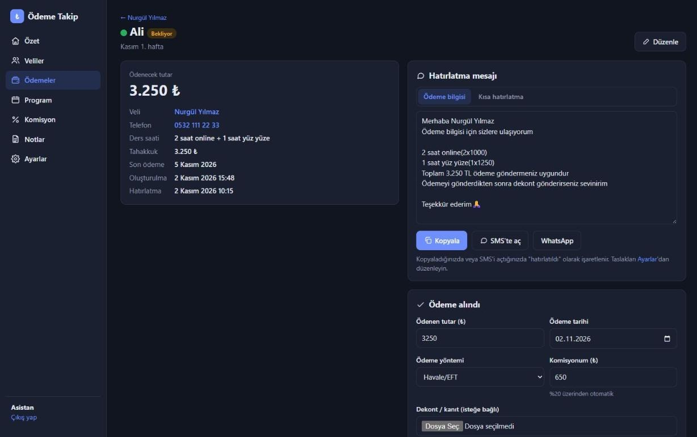
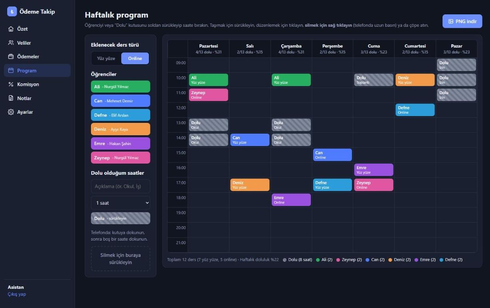
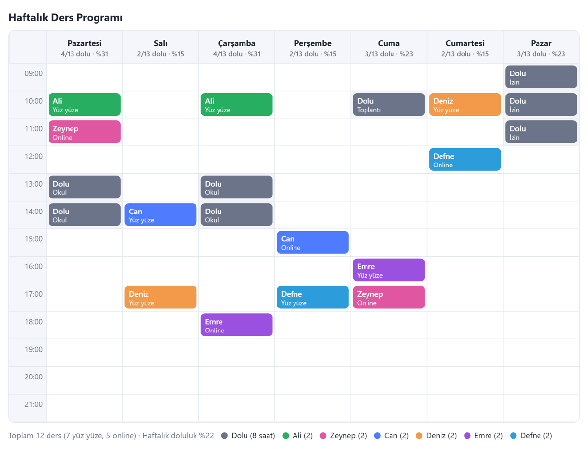
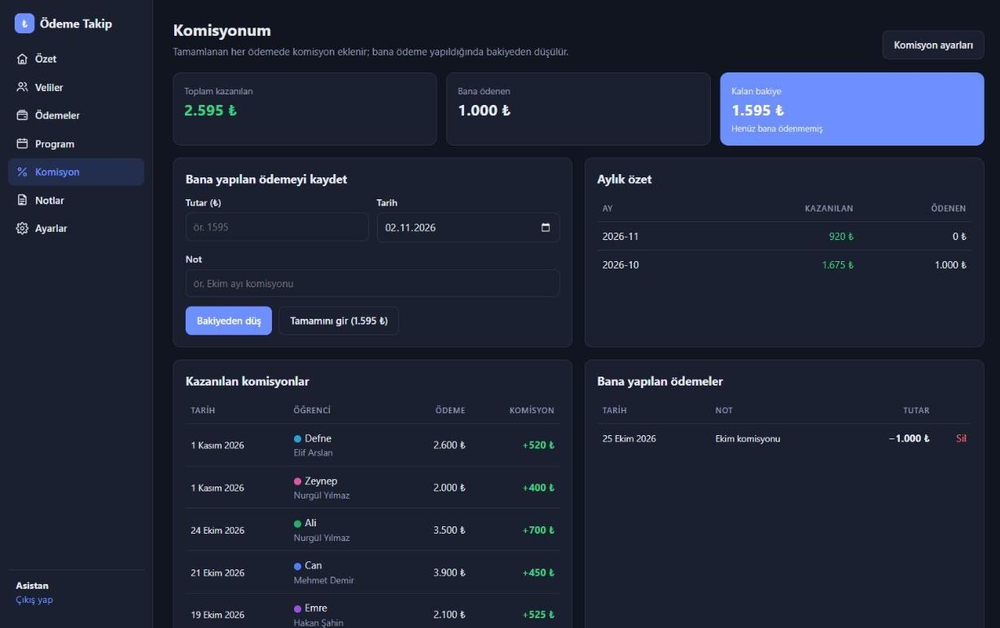
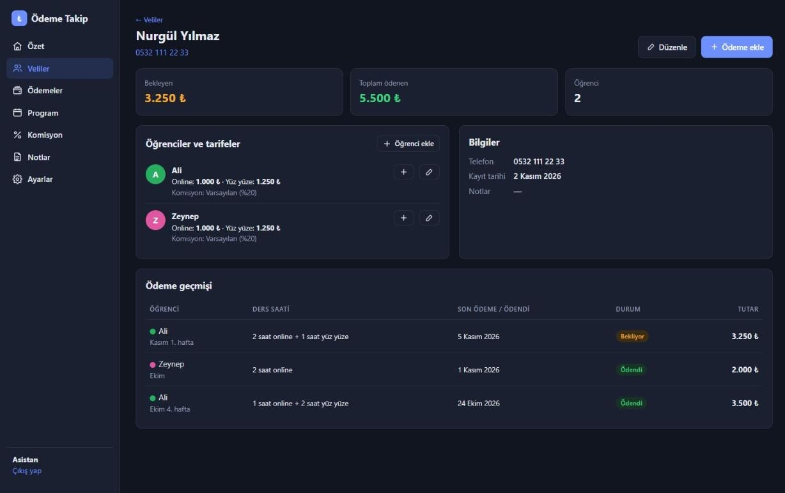

# Ders Defteri

**Özel ders velilerinin ödemelerini, asistan komisyonunu ve haftalık ders programını tek yerden takip eden, kendi sunucunuzda çalışan küçük bir web uygulaması.**

Veliyi ve çocuğunu ekleyin, verilen ders saatlerini girin, tek tıkla hazır ödeme mesajını gönderin, dekontu yükleyip ödemeyi kapatın. Asistan payı otomatik hesaplanır; haftalık program sürükle-bırak ile hazırlanır ve PNG olarak paylaşılır.



> Görsellerdeki tüm isimler ve tutarlar uydurma demo verisidir.

---

## İçindekiler

- [Özellikler](#özellikler)
- [Ekran görüntüleri](#ekran-görüntüleri)
- [Örnek iş akışı](#örnek-iş-akışı)
- [Teknoloji](#teknoloji)
- [Yerelde çalıştırma](#yerelde-çalıştırma)
- [Sunucuya kurulum (Ubuntu, Docker'sız)](#sunucuya-kurulum-ubuntu-dockersız)
- [Güncelleme](#güncelleme)
- [Yedekleme ve geri yükleme](#yedekleme-ve-geri-yükleme)
- [Mesaj taslakları](#mesaj-taslakları)
- [Komisyon hesabı](#komisyon-hesabı)
- [Veli / öğrenci portalı](#veli--öğrenci-portalı)
- [Google Takvim (taslak)](#google-takvim-taslak)
- [Güvenlik](#güvenlik)
- [Proje yapısı](#proje-yapısı)
- [Yönetim komutları](#yönetim-komutları)
- [Testler](#testler)

---

## Özellikler

| | |
|---|---|
| 🔐 **Giriş zorunlu** | Oturum açmadan hiçbir sayfa görünmez. Hatalı şifre denemelerine karşı kilit, CSRF koruması, güvenli çerezler. Birden fazla tam yetkili kullanıcı. |
| 👨‍👩‍👧 **Veliler ve öğrenciler** | Bir veliye birden fazla çocuk. Her çocuğa bir renk ve kendi tarifesi (online / yüz yüze saatlik ücret). |
| 💳 **Ödemeler** | Ders saati girilince tutar tarifeden otomatik hesaplanır; **küsuratlı saat** desteklenir (ör. 1,5 saat). Son ödeme tarihi, gecikme takibi, iptal / geri alma. |
| ➗ **Kısmi ödeme ve veli bakiyesi** | Veli eksik öderse kalan tutar velinin bakiyesine borç yazılır (veya hemen yeni ödeme açılır); fazla öderse alacak yazılır. Sonraki ödemede tek tıkla eklenir/düşülür ve mesajda ayrı satır olarak görünür. |
| 💬 **Hazır mesaj** | Velinin adı, ders satırları ve toplam tutarla dolu mesaj; tek tıkla kopyala, telefonun SMS uygulamasında veya WhatsApp'ta aç. |
| 🧾 **Dekont** | Ödeme kapatılırken resim veya PDF dekont eklenir; dosyalar yalnızca giriş yapmış kullanıcılara gösterilir. |
| 💰 **Asistan komisyonu** | Varsayılan olarak yüzde veya saat başı sabit tutar; öğrenciye özel oran tanımlanabilir. Kazanılan, ödenen ve kalan bakiye ayrı sayfada. |
| 📅 **Haftalık program** | Tarihli, hafta hafta gezilebilen program; her haftanın programı ayrıdır, "Geçen haftayı kopyala" ile tek tıkla doldurulur. Öğrenciyi sürükleyip saate bırakın; yüz yüze / online seçimi, günlük doluluk oranı, müsait günler. **PNG olarak indir.** |
| 🎉 **Resmi tatiller ve özel günler** | Ulusal ve dini bayramlar (arifeler yarım gün) programda kırmızı görünür; yarıyıl tatili, sınav haftası gibi günleri tarih aralığıyla kendiniz ekleyin. |
| 📚 **Ders kayıtları** | Programdaki derse tıklayıp “derste işlenen konu” yazın; ödev, PDF ve görsel ekleyin. Programda olmayan dersler elle girilir. “Sadece bize not” veli/öğrenciye görünmez. |
| 👪 **Veli ve öğrenci portalı** | Ayrı alan adında (ör. `portal.ornek.com`) veli: çocuklarının programı, işlenen konular, PDF'ler, ödemeler ve bakiye; öğrenci: sadece programı ve işlenen konular. Hesaplar veli sayfasından tek tıkla, hazır giriş mesajıyla. |
| 🔄 **Google Takvim (taslak)** | Dersler Google Takvime yazılır, Google'daki etkinlikler programda “Dolu” görünür. Google Cloud kimlik bilgileri girilene kadar kapalıdır. |
| ⛔ **Dolu saatler** | Ders dışında meşgul olduğunuz saatleri (okul, iş…) açıklamayla işaretleyin; dolu saate ders eklenemez. |
| 🖱️ **Hızlı düzenleme** | Programda sağ tıkla (telefonda uzun basarak) sil, 5 saniye içinde "Geri al". |
| 📝 **Ortak notlar** | Kullanıcılar arasında not paylaşımı; sabitleme ve tamamlandı işareti. |
| 🔔 **Telegram bildirimi** | Her sabah 09:00'da bugün/yarın son günü olan ve geciken ödemelerin özeti Telegram'a gelir. |
| 📊 **Raporlar** | Aylık tahsilat, komisyon, öğrenci bazında ders saati; Excel'de açılan CSV indirme. Veli için yazdırılabilir / PDF **hesap dökümü**. |
| 🕓 **İşlem geçmişi** | Kim, ne zaman, ne yaptı: ödeme, veli, program, ayar ve giriş kayıtları; her ödemenin kendi geçmişi. |
| 💾 **Haftalık yedek** | Her pazar otomatik yedek: **veritabanı + tüm dekontlar** tek dosyada; toplam 100 MB'ı aşınca en eski yedekler silinir. Ayarlar'dan elle yedek alıp indirin. |
| 📱 **Telefona kurulabilir (PWA)** | "Ana ekrana ekle" ile uygulama gibi açılır; telefonda alt menü, dokun-dokun ile program düzenleme. Açık / koyu tema otomatik. |
| 🙈 **Arama motorlarına kapalı** | `robots.txt` tüm botları ve bilinen yapay zekâ tarayıcılarını engeller; tüm sayfalarda `noindex` başlığı. |

---

## Ekran görüntüleri

### Ödemeler
Tüm ödemeler, özet kartları ve durum filtreleri (Tümü / Bekleyen / Geciken / Ödenen / İptal).



### Ödeme detayı: hazır mesaj ve tahsilat
Mesaj, ödemedeki ders saatlerinden otomatik oluşur. "Ödeme alındı" formunda komisyon canlı hesaplanır, dekont eklenebilir.



### Haftalık program
Hafta hafta gezilir; gün başlıklarında tarih, doluluk oranı ve varsa resmi tatil / özel gün yazar. Öğrenciler ve "Dolu" kutusu soldan sürüklenir.



"PNG indir" butonunun ürettiği paylaşılabilir görsel:



### Komisyon
Tamamlanan her ödemede asistan payı eklenir; asistana yapılan ödemeler bakiyeden düşülür.



### Veli detayı
Çocuklar, tarifeleri, öğrenciye özel komisyon ve tüm ödeme geçmişi.



---

## Örnek iş akışı

1. **Veliler → Yeni veli:** "Nurgül Yılmaz" ve telefonu eklenir.
2. **Öğrenci ekle:** Çocuğu "Ali", renk seçilir; tarife online 1000 ₺, yüz yüze 1250 ₺.
3. **Ödeme ekle:** 2 saat online + 1 saat yüz yüze girilir → tutar otomatik **3.250 ₺**.
4. **Hatırlatma:** Ödeme sayfasında hazır mesaj "Kopyala" veya "SMS'te aç" ile gönderilir; ödeme "hatırlatıldı" olarak işaretlenir.
5. **Ödeme alındı:** Dekont yüklenir, "Ödemeyi tamamla" denir. Varsayılan %20 ile **650 ₺** komisyon bakiyeye eklenir.
6. **Komisyon:** Asistana ödeme yapıldığında "Bakiyeden düş" ile kaydedilir.

---

## Teknoloji

- **Python 3.10+**, **Flask**, **SQLite** (WAL modu)
- Sunucu tarafında Jinja şablonları; istemcide saf JavaScript ve CSS (derleme adımı yok)
- [html2canvas](https://html2canvas.hertzen.com/) (PNG dışa aktarma, depoya dahil)
- Üretimde **gunicorn** + **systemd**; dışarıya Cloudflare Tunnel veya nginx ile açılır
- Docker gerekmez; uygulama ~30 MB RAM kullanır

---

## Yerelde çalıştırma

```bash
git clone https://github.com/Asimmimx/ders-defteri.git
cd ders-defteri

python -m venv .venv
# Windows: .venv\Scripts\activate    Linux/macOS: source .venv/bin/activate
pip install -r requirements.txt

python manage.py create-user asistan --name "Asistan"   # şifre sorar
python manage.py run                                     # http://127.0.0.1:5000
```

Veriler varsayılan olarak proje içindeki `data/` klasöründe tutulur (git'e girmez).

---

## Sunucuya kurulum (Ubuntu, Docker'sız)

```bash
sudo git clone https://github.com/Asimmimx/ders-defteri.git /opt/odemetakip
sudo bash /opt/odemetakip/deploy/install.sh
cd /opt/odemetakip && sudo -u odemetakip .venv/bin/python manage.py create-user asistan --name "Asistan"
```

`deploy/install.sh` şunları yapar:

- `python3-venv` paketini kurar, `odemetakip` adlı sistem kullanıcısını oluşturur
- Verileri `/var/lib/odemetakip` altında tutar (veritabanı, dekontlar, yedekler)
- Rastgele `SECRET_KEY` içeren `.env` dosyası oluşturur (yalnızca ilk kurulumda)
- Sanal ortamı kurar, `odemetakip.service` (gunicorn, `127.0.0.1:8098`), `odemetakip-backup.timer` (pazar 03:00)
  ve `odemetakip-notify.timer` (her gün 09:00 Telegram özeti) servislerini etkinleştirir

Uygulama yalnızca `127.0.0.1:8098` adresini dinler. Dışarıya açmak için:

**Cloudflare Tunnel**

```yaml
ingress:
  - hostname: odeme.ornek.com
    service: http://127.0.0.1:8098
  - service: http_status:404
```

```bash
cloudflared tunnel route dns <tünel-adı> odeme.ornek.com
```

**nginx**

```nginx
server {
    server_name odeme.ornek.com;
    client_max_body_size 15m;
    location / {
        proxy_pass http://127.0.0.1:8098;
        proxy_set_header Host $host;
        proxy_set_header X-Forwarded-For $proxy_add_x_forwarded_for;
        proxy_set_header X-Forwarded-Proto $scheme;
    }
}
```

### Ortam değişkenleri (`.env`)

| Değişken | Açıklama |
|---|---|
| `SECRET_KEY` | Oturum imzalama anahtarı (uzun ve rastgele olmalı) |
| `COOKIE_SECURE` | HTTPS arkasında `1` |
| `DATA_DIR` | Veritabanı, dekont ve yedek klasörü |
| `PORTAL_HOST` | Portal alan adı (ör. `portal.ornek.com`). Bu alan adında sadece portal sayfaları açılır. |

---

## Güncelleme

```bash
cd /opt/odemetakip && sudo git pull && sudo bash deploy/install.sh
```

Veritabanı şeması uygulama açılırken otomatik güncellenir; mevcut veriler korunur.

---

## Yedekleme ve geri yükleme

- `odemetakip-backup.timer` her **pazar 03:00**'te `manage.py backup` çalıştırır.
- Yedekler `DATA_DIR/backups/odeme-YYYYMMDD-HHMMSS-*.tar.gz` dosyasıdır; içinde `odeme.db` ve `uploads/` (dekontlar) bulunur.
- Toplam boyut **100 MB**'ı aşınca en eski yedekler silinir (en yeni yedek her zaman korunur).
- Ayarlar → Veritabanı yedekleri bölümünden elle yedek alınabilir ve indirilebilir.

Geri yükleme:

```bash
sudo systemctl stop odemetakip
cd /var/lib/odemetakip
sudo -u odemetakip sh -c 'rm -f odeme.db-wal odeme.db-shm && tar -xzf backups/odeme-20261108-030000-haftalik.tar.gz'
sudo systemctl start odemetakip
```

> `tar -xzf` hem `odeme.db` dosyasını hem `uploads/` klasörünü yerine koyar. Eski sürümden kalan `.db.gz` yedekler için:
> `gunzip -c backups/<dosya>.db.gz > odeme.db`

---

## Mesaj taslakları

Ayarlar → SMS / mesaj taslakları bölümünden düzenlenir. Kullanılabilen alanlar:

| Alan | Örnek çıktı |
|---|---|
| `{veli}` | Nurgül Yılmaz |
| `{ogrenci}` | Ali |
| `{ders_listesi}` | `2 saat online(2x1000)` ve alt satırda `1 saat yüz yüze(1x1250)` |
| `{tutar}` | 3.250 TL |
| `{onceki_bakiye}` | Önceki dönemden kalan: 250 TL (yoksa boş; `{ders_listesi}` içinde de otomatik yer alır) |
| `{ders_sayisi}` | 3 |
| `{ders_detay}` | 2 saat online + 1 saat yüz yüze |
| `{son_odeme}` | 5 Kasım 2026 |
| `{aciklama}` | Kasım 1. hafta |

Varsayılan taslak:

```text
Merhaba {veli}
Ödeme bilgisi için sizlere ulaşıyorum

{ders_listesi}
Toplam {tutar} ödeme göndermeniz uygundur
Ödemeyi gönderdikten sonra dekont gönderirseniz sevinirim

Teşekkür ederim🙏
```

---

## Komisyon hesabı

- **Yüzde:** `komisyon = ödenen tutar × oran / 100`
- **Saat başı sabit:** `komisyon = toplam ders saati × sabit tutar`
- Öğrenciye özel komisyon tanımlıysa o, değilse Ayarlar'daki varsayılan kullanılır.
- Komisyon ödeme **tamamlandığında** hesaplanır ve kayda yazılır; ayar sonradan değişse de eski kayıtlar değişmez. Tamamlarken tutar elle de düzeltilebilir.
- Ödeme oluşturulurken o anki saat ücretleri de kaydedilir; tarife değişse de eski ödemelerin tutarı ve mesajı bozulmaz.
- Kısmi ödemede komisyon **ödenen tutar** üzerinden hesaplanır; kalan tutar sonradan ödendiğinde onun komisyonu da eklenir.

---

## Veli / öğrenci portalı

- Portal `/portal/` altındadır. `.env` içinde `PORTAL_HOST` verilirse o alan adında **yalnızca** portal açılır (yönetim sayfaları 404), kök adres portala yönlenir.
- Hesaplar: Veliler → veli → **Portal erişimi** → “Veli hesabı oluştur” / “Öğrenci hesabı oluştur”. Kullanıcı adı addan üretilir, şifre rastgeledir ve **sadece bir kez** hazır mesajla gösterilir (kopyala / WhatsApp). Şifre sıfırlama, kapatma ve silme aynı yerden.
- Portal hesapları personel hesaplarından ayrı tablodadır (`portal_users`) ve ayrı oturum anahtarı kullanır; portal oturumu yönetim sayfalarını açamaz.
- Veli: çocuklarının programı, işlenen konular/ödevler, dosyalar, ödemeler ve bakiye. Öğrenci: sadece kendi programı ve işlenen konular. Komisyon, iç notlar ve “sadece bize not” hiçbir yerde gösterilmez.
- Ayarlar → Veli / öğrenci portalı: giriş mesajında yazan adres.

## Google Takvim (taslak)

Kod hazırdır ama Google Cloud'da OAuth istemcisi oluşturulup **Ayarlar → Google Takvim**'e girilene ve “Google ile bağlan” yapılana kadar hiçbir şey göndermez.

- Buradan Google'a: eklenen / taşınan / silinen dersler Google Takvim etkinliği olarak yazılır, güncellenir, silinir.
- Google'dan buraya: Google Takvimdeki (bizim yazmadığımız, tüm gün olmayan) etkinlikler programda “Dolu · Google: …” olarak görünür.
- Senkron `python manage.py gcal-sync` ile çalışır; 5 dakikada bir için sunucuda `systemctl enable --now odemetakip-gcal.timer`.
- Kurulum adımları Ayarlar sayfasında yazılıdır.

## Telegram bildirimi

1. Telegram'da **@BotFather** → `/newbot` ile bir bot oluşturun, verilen anahtarı (token) kopyalayın.
2. Ayarlar → Telegram bildirimi bölümüne anahtarı yapıştırıp kaydedin.
3. Botunuza Telegram'dan `/start` yazın, sonra **Chat ID'yi otomatik bul** butonuna basın.
4. **Test mesajı gönder** ile deneyin, **Günlük bildirimi aç** kutusunu işaretleyin.

Bildirim her gün 09:00'da `odemetakip-notify.timer` ile gönderilir; elle denemek için: `python manage.py notify --force`.

---

## Arama motorları ve yapay zekâ botları

- `/robots.txt` tüm botlara `Disallow: /` döner; GPTBot, ClaudeBot, Google-Extended, PerplexityBot, CCBot gibi
  bilinen yapay zekâ tarayıcıları ayrıca adıyla engellenir.
- Her yanıtta `X-Robots-Tag: noindex, nofollow, noarchive, nosnippet, noimageindex, noai, noimageai`, her sayfada `noindex` meta etiketi vardır.
- Giriş sayfası dışındaki tüm içerik zaten oturum ister; botlar içeriği göremez.
- Cloudflare kullanıyorsanız ek olarak *Security → Bots → Block AI Scrapers and Crawlers* seçeneğini açabilirsiniz.

---

## Güvenlik

- Parolalar `werkzeug` ile hash'lenir; düz metin saklanmaz.
- 15 dakikada 8 hatalı girişten sonra IP geçici olarak kilitlenir (`CF-Connecting-IP` desteklenir).
- Tüm formlar ve API çağrıları CSRF jetonu ister.
- Çerezler `HttpOnly`, `SameSite=Lax`, HTTPS'te `Secure`.
- Dekontlar statik klasörde değil, veri klasöründe; yalnızca oturum açmış kullanıcılar indirebilir. İzin verilen türler: jpg, png, webp, heic, gif, pdf (en fazla 15 MB).
- Sayfalar arama motorlarına kapalıdır (`noindex`).

---

## Proje yapısı

```text
app/
  __init__.py      Uygulama fabrikası, CSRF, hata sayfaları, filtreler
  db.py            SQLite bağlantısı, şema kurulumu, otomatik geçişler
  schema.sql       Tablo tanımları
  auth.py          Giriş / çıkış, oturum kontrolü, giriş kilidi
  main.py          Özet sayfası, veliler, öğrenciler
  payments.py      Ödemeler, mesaj oluşturma, dekont, tamamlama
  commission.py    Komisyon sayfası, asistana yapılan ödemeler
  schedule.py      Haftalık program ve dolu saatler (JSON API)
  lessons.py       Ders kayıtları: işlenen konu, ödev, PDF/görsel
  portal.py        Veli / öğrenci portalı (ayrı giriş)
  access.py        Portal hesaplarını yönetme (personel tarafı)
  gcal.py          Google Takvim senkronu (taslak)
  notes.py         Ortak notlar
  reports.py       Aylık raporlar, CSV dışa aktarma
  audit.py         İşlem geçmişi kaydı
  notify.py        Telegram bildirimleri
  public.py        robots.txt, PWA manifest ve service worker
  settings.py      Ayarlar, taslaklar, kullanıcılar, yedekler
  backup.py        Yedek alma ve 100 MB sınırı
  utils.py         Para/tarih biçimleri, komisyon hesabı
  templates/       Jinja şablonları
  static/          CSS, JavaScript, html2canvas
deploy/            install.sh ve systemd servis dosyaları
docs/screenshots/  README görselleri
tests/             Uçtan uca testler
manage.py          Yönetim komutları
wsgi.py            gunicorn giriş noktası
```

---

## Yönetim komutları

| Komut | Açıklama |
|---|---|
| `python manage.py create-user <ad> [--name "Ad Soyad"]` | Yeni kullanıcı (şifre sorar) |
| `python manage.py set-password <ad>` | Şifre sıfırla |
| `python manage.py backup` | Elle yedek al (veritabanı + dekontlar) |
| `python manage.py notify [--force]` | Telegram günlük özetini şimdi gönder |
| `python manage.py gcal-sync` | Google Takvim senkronu (bağlı değilse bir şey yapmaz) |
| `python manage.py run [--port 5000]` | Geliştirme sunucusu |

Sunucuda komutları `odemetakip` kullanıcısıyla çalıştırın:
`cd /opt/odemetakip && sudo -u odemetakip .venv/bin/python manage.py <komut>`

---

## Testler

```bash
python -m unittest discover tests
```

Testler geçici bir veritabanıyla giriş, veli/öğrenci, ödeme, küsuratlı saat, kısmi ödeme ve veli bakiyesi, mesaj, dekont, komisyon, notlar, program, dolu saatler, işlem geçmişi, raporlar, Telegram, robots/PWA ve yedekleme akışlarını uçtan uca dener.
